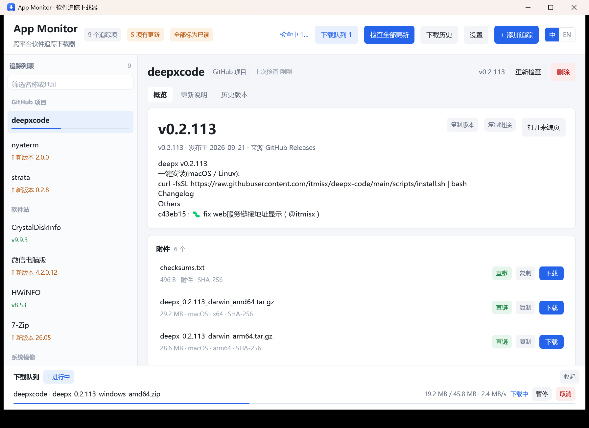
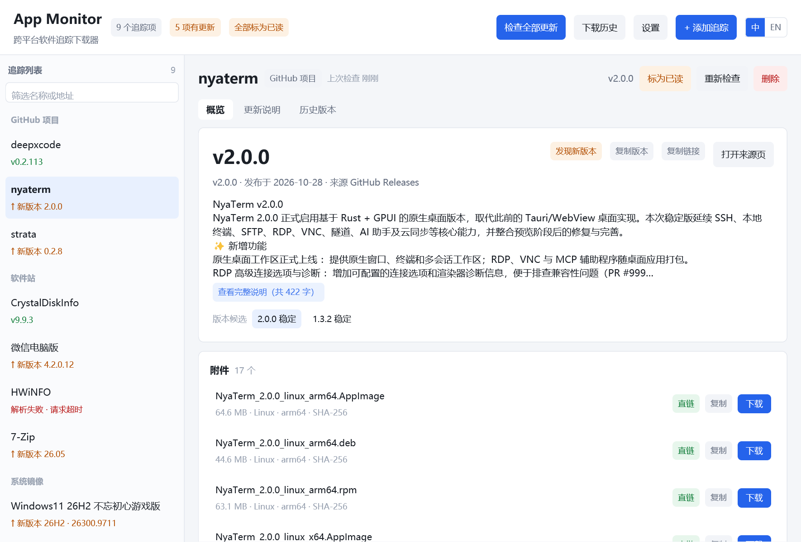

# App Monitor · cross-platform release tracker


**English** · [简体中文](README.md)


A small desktop tool written in Rust + GPUI: **hand it a list of "site / repo + software name" and it watches for new versions for you**. Version number, publish date, release notes and direct download links are collected onto one card — you decide whether to download, and it does the downloading (resumable, SHA-256 verified).


```
┌───────────────┬──────────────────────────────────────────────────────┐
│ App Monitor   │ cross-platform release tracker · 9 tracks · DL 1     │
├───────────────┼──────────────────────────────────────────────────────┤
│ Tracks    9   │ nyaterm                        Up to date            │
│ GitHub    3   │ GitHub · nyakang/nyaterm · GitHub Releases           │
│  deepxcode    │ Overview │ Release notes │ Past versions             │
│  █████░░░░░░  │ ┌──────────────────────────────────────────────────┐ │
│  nyaterm      │ │ Latest  1.3.0    ⚠ pre-release 2.0.0-preview7    │ │
│  strata       │ │ Summary of the release …                         │ │
│ Sites     4   │ │ Files 17: windows_x64.msi · 24.8 MB · sha…       │ │
│               │ └──────────────────────────────────────────────────┘ │
└───────────────┴──────────────────────────────────────────────────────┘
```

Download progress only shows up as a thin bar under the matching row on the left; hover that row and a detail card floats out. The bottom queue is collapsed by default — click the **Downloads** button in the top bar to open it.







## Download (prebuilt)

Grab a build from [Releases](https://github.com/lordquest/app_monitor/releases) and unzip — that's it:

| Platform | File |
| --- | --- |
| Windows x64 | `app-monitor-v0.2.1-windows-x64.zip` (`app-monitor.exe`, Windows 10 or newer) |
| Linux x64 | `app-monitor-v0.2.1-linux-x64.tar.gz` (needs X11/Wayland + a Vulkan driver) |
| macOS arm64 (Apple Silicon) | `app-monitor-v0.2.1-macos-arm64.tar.gz` (unsigned; if Gatekeeper blocks it, run `xattr -d com.apple.quarantine ./app-monitor`) |

The Windows binary is smoke-tested on Windows; the Linux / macOS binaries come from the same source built by GitHub Actions. The version lives in the tag — this repo is currently at `0.2.1`.

## Features

- **Paste, and it figures it out**: one "address or software name" per line. It detects whether that is a GitHub repo, a product on a download site's front page, or a specific article page, and de-duplicates repeats.
- **Multiple sources**
  - GitHub: parsed from `releases.atom` + `releases/expanded_assets/<tag>`, so the REST API quota is untouched; the REST API is only a fallback for private repos or odd cases.
  - Software sites (WordPress / ZBlog style): site search `?s=<keyword>` → score the results → fetch the article body → extract download links, version and release notes.
  - A single article: parsed directly.
- **Versions you can read**: stable releases win; sub-crate releases mixed into the same repo (`ignore-0.4.33`) are down-ranked.
- **Multiple version candidates**: when a repo publishes several lines at once (nyaterm's stable `1.3.0` alongside preview `2.0.0-preview.7`), the version card lists up to three candidate tags in its lower right corner. One click swaps the file list and release notes to that version, and pre-releases are marked in orange.
- **Mark updates as read**: when the newest release is newer than "the version you last looked at", the list shows an orange `↑ new x.y.z` and the top bar shows `N updates`. Once you have seen it, hit **Mark as read** on the detail page, or **Mark all as read** in the top bar to clear the lot. Marking only moves the "seen up to" pointer — the detail page still shows the latest version, and the reminder only comes back when upstream actually ships something new.
- **A real downloader**: `Range` resume, `.part` temp files, pause / resume / cancel / retry, a concurrency cap, and SHA-256 verification on completion (GitHub publishes a digest per asset).
- **Every takeaway has a button**: the `link` / `page` tag on an asset row is itself the action (download / open in browser), with **Copy** next to it for the URL. The version card has **Copy version** and **Copy link**, release notes have **Copy all** — version numbers and file names still go through buttons (the body text itself is drag-selectable, see two bullets down).
- **Bilingual UI + UI scale**: the **中 / EN** switch sits at the far right of the top bar; it takes effect immediately and is written to `config.json`. Leave `lang` empty to follow the system language (that is what first launch does). Font size is adjustable from 80% to 180% in 10% steps, so high-DPI screens stop being a squint test (the default size is also one step larger than v0.1).
- **Drag to select and copy in the overview body**: GPUI has no text selection, so selection highlighting and hit-testing are built on top of its layout results (see below). Release the mouse and the text is already in the clipboard; for an explicit route, right-click the selection for **Copy / Select all / Clear selection**. The selection survives a copy so you can keep extending it.
- **History and progress**: a downloading row carries a thin progress bar in the left list, and hovering it shows bytes / speed / status. The full queue (pause, resume, cancel, retry, open file or folder) lives behind the **Downloads N** button in the top bar — open it and it takes space, click again and it is gone. There is also a history page (success / failure, verification result, open file or folder).
- **Portable**: data lives in `app_monitor_data/` next to the executable by default, so moving the folder moves everything.

## Quick start

```bash
cargo run            # dev run (Windows 10+; the UI uses D3D11)
cargo run --release  # release run
```

If `cargo build --release` fails on Windows with `cl.exe exit code 2` (MSVC environment probing blocked by policy), use the bundled wrapper:

```bat
build-release.cmd
```

Output: `target/release/app-monitor.exe`, data in `target/release/app_monitor_data/`.

The Windows build statically links the MSVC runtime (`/MT`) via `-C target-feature=+crt-static` in `.cargo/config.toml`, so the binary does not depend on `VCRUNTIME140.dll` / `api-ms-win-crt-*.dll` and runs by double-click on machines without the VC++ redistributable. The cost is roughly 200 KB of extra size. Linux / macOS builds are unaffected by that setting.

### Automated releases (GitHub Actions)

`.github/workflows/release.yml` runs `cargo build --release` on three runners in parallel (Windows x64 / Linux x64 / macOS arm64) and uploads the packaged results:

```bash
git tag -a v0.2.1 -m "app-monitor v0.2.1"   # tagging triggers the build + Release
git push origin v0.2.1
```

- Push a `v*` tag → when the build finishes a Release is created with the three platform archives attached (including `README.md` / `LICENSE`).
- Run `workflow_dispatch` from the Actions page → build only, keep the artifacts for 14 days, no release. Handy for a dry run.
- Builds use `Swatinem/rust-cache`; the Linux leg installs the X11 / Wayland / fontconfig / freetype / Vulkan development packages GPUI needs.
- Actions minutes are free for public repos; release assets count against the repo's bandwidth.

First launch seeds a built-in sample list (the one used to develop this project). Press `Ctrl+N` to paste your own.

## Supported input syntax

One entry per line in the paste box; mixing is fine:

```
https://github.com/itmisx/deepx-code  deepxcode          # repo + nickname
https://github.com/hooke007/mpv_PlayKit/releases  mpv-lazy @scene#54:"daily dev"
                                                          # @scene#N:"group name" groups the line above
https://www.423down.com/                                  # site root, opens the "site search" context
CrystalDiskInfo                                           # every following line is a keyword on that site
微信电脑版
7-Zip
https://masuit.org/                                       # masuit.org blog (site search at /search?wd=)
HWiNFO
https://www.pc528.net/
Windows11 26H2  不忘初心游戏版
https://www.423down.com/5228.html 7-Zip                    # a specific article page
```

Rules:

- A line containing a URL switches the **current context**; bare text lines that follow belong to that site.
- `@scene#54:"daily dev"` / `@scene#7:tools` — quotes are optional. On a line of its own it applies to the **next** line.
- Lines starting with `#` or `//` are comments.

## Parsing strategy per source

| Source | How | Notes |
| --- | --- | --- |
| GitHub repo | `releases.atom` → newest entry → `releases/expanded_assets/<tag>` | Asset size, upload date and `sha256:` digests are all in the fragment; update manifests such as `.json/.blockmap/.yml` are skipped |
| Software site | `?s=<keyword>` search → title scoring → article body | Scoring uses Chinese bigrams, synonyms (电脑版 → pc版) and penalty words (patch / plugin / keygen / old version…) so it does not latch onto "the patch for X" |
| 423down | as above; `/go.php?url=<base64>` is decoded into the real netdisk URL | |
| pc528 | as above; a first 403 + `Set-Cookie` challenge is retried once | The download section requires login; the card says so |
| masuit.org | site search goes to `/search?wd=<keyword>`, results are `article-card` blocks (no `<h2>`) | Only Lanzou links are listed, so downloads open in the browser |
| Generic | body sliced by containers such as `entry-content`; anchors classified as direct link / web page / netdisk | Direct links are ordered "current OS > unknown > other OS", with checksum-like files pushed to the back |

## Multiple version candidates (release lines)


Different release lines of the same repo are collected under "version candidates" — up to three tags — instead of burying the pre-release in a one-line warning:

| Example | Candidates | Notes |
| --- | --- | --- |
| `nyaterm` | `1.3.0 stable` / `2.0.0-preview.7 preview` / `1.2.12 stable` | The stable release stays "latest"; the preview sits next to it with an orange tag |
| `mpv_PlayKit` | just 1 | Date-style tags (`20260510`) belong to one line, so you do not get a new tag every day |
| `deepx-code` | just 1 | `0.2.x` is a single line; older versions live under "past versions" |

Rule: merge by `major.minor` (`2.0.0-preview.7` → `2.0`), keep only the newest entry per line. Stable first, then preview lines, then the rest. Switching tags only changes what is displayed and which asset is downloaded; `seen_version` (the update prompt) always follows the stable release.

## Download behaviour

- Direct links (`.exe/.zip/.msi/.7z/.dmg/.tar.gz`…) are queued into `<download dir>/<app>/<version>/`; a name clash gets a ` (1)` suffix.
- Netdisk and redirect pages are never downloaded silently — they only open in the browser (**Open link**).
- Download requests carry the origin page as `Referer` plus the site's cookies (some sites check referrers).
- **No overall timeout for large files**: the download client only has a 15s connect timeout and a 30s "read stalled" detector; the transfer itself is not time-boxed (174 MB at 2 MB/s takes 90s, and a blanket deadline would kill perfectly healthy downloads). Page parsing keeps its 55s overall limit.
- **Automatic resume on drops**: when a read times out mid-transfer or the peer closes early, the task resumes internally with `Range` (failure only after 3 consecutive no-progress attempts or 20 in total) — no need to click resume.
- Finished tasks offer **Open file** / **Open folder**; failed tasks offer **Retry**; finished tasks can be cleared in one go.

## Data files

`app_monitor_data/` (next to the executable; falls back to the system data directory when not writable):

| File | Contents |
| --- | --- |
| `config.json` | Download directory, GitHub token, proxy, concurrency, auto-check toggle/interval |
| `tracks.json` | Track list plus the last parse result (so you still see the previous data offline) |
| `history.json` | Download history (max 500 entries) |

**Unreadable files are never silently wiped**: if `config.json` / `tracks.json` / `history.json` is invalid JSON (hand-edited wrong, clobbered by another program) or zero bytes (power loss mid-write), the file is first renamed to `<name>.<UTC timestamp>Z.corrupt` in the same directory, the app starts from defaults, and a banner at the top of the window says which file it was and what the backup is called. Older versions simply fell back to the default list and overwrote the original on the next save — taking your hand-made tracks and token with it.

Settings (`Ctrl+,`):

- **Download directory**: defaults to `<system downloads>/AppMonitor`, changeable to any path (the current instance points at `downloads/` inside the project); files are archived as `<app>/<version>/`.
- **GitHub token (optional)**: only used when falling back to the REST API; the atom path costs no quota.
- **Proxy**: empty means a direct connection; `HTTPS_PROXY` is honoured too.
- **Concurrent downloads / auto-check interval (minutes)**.

## Security trade-offs in the download path

- **https → http downgrade redirects are refused**: once HTTPS bounces back to plaintext, any hop on the path (public WiFi, ISP injection, transparent proxy) can swap the installer — and this program expects you to double-click what it downloaded. Assets outside GitHub usually have no SHA-256 to compare against, so the swap would never be noticed. The redirect chain is capped at 12 hops.
- **Links that were http to begin with are not blocked**: that is the site's existing reality, and hard-blocking would kill a large set of domestic sites that only serve http. Those links are marked with a red `· plain http` in the download list and left to your judgement.
- **No digest means no digest**: assets outside GitHub usually have no official SHA-256, so the list says `· no official digest, cannot verify` instead of implying a check happened.

Real sites occasionally misbehave (an https page redirecting to an http CDN). There is an escape hatch — **it relaxes downloads only; parsing stays strict** (page content determines the version number and the next download URL, so a swapped page means someone else is driving every decision):

```bash
AM_ALLOW_DOWNGRADE=1 app-monitor    # Windows: set AM_ALLOW_DOWNGRADE=1 && app-monitor.exe
```

With it on, startup logs a warning that the payload may be replaced in transit.

## Keyboard shortcuts

| Key | Action |
| --- | --- |
| `Ctrl+1 / 2 / 3` | Overview / release notes / past versions |
| `Ctrl+N` | Add a track |
| `Ctrl+F` | Focus the sidebar filter |
| `Ctrl+H` | Download history |
| `Ctrl+,` | Settings |
| `Esc` | Close the dialog |

## Command-line self-check

```bash
app-monitor --check            # parse every track, print version / summary / assets / warnings
app-monitor --check HWiNFO     # only tracks whose name contains HWiNFO
app-monitor --check --verbose  # also print the start and length of the body, for parser debugging
app-monitor --fetch <url> [--save out.html]   # fetch one page with the app's own HTTP stack, show status/title
app-monitor --download-test    # really download the first GitHub asset for Windows and verify SHA-256 into ./.selftest
app-monitor --download Netcatty --asset win-x64.zip   # download a named asset (for reproducing large files / resume issues)
app-monitor --select nyaterm              # open the GUI focused on one track
app-monitor --select nyaterm --cand 1     # also open the 2nd version candidate (for screenshots / repros)
```

`--check` needs no display, so it drops nicely into a scheduled job.

## UI layer (GPUI)

The UI is built on [GPUI](https://www.gpui.rs/) (Zed's GPU UI framework). There is exactly one UI — no side-by-side branch. Why egui was replaced:

- One rendering path, no hand-maintained "DX12 → WARP → glow" backend selection and fallback chain: Windows uses Direct3D 11 + DirectComposition, macOS uses Metal, Linux uses Vulkan/blade.
- A much smaller dependency tree (no eframe / egui / wgpu / naga / glow): `Cargo.lock` went from 833 packages to 724 — 109 fewer crates, about 1.3k lines of lockfile.

The price is **Windows 10 or newer only**: D3D11 + DirectComposition are incomplete on earlier systems. Win7/8 users should stay on [v0.1.2](https://github.com/lordquest/app_monitor/releases/tag/v0.1.2) (the last egui build).

```bash
AM_LOG=1 app-monitor              # turn on debug logging
AM_ALLOW_DOWNGRADE=1 app-monitor  # allow https → http downgrades for downloads (escape hatch, see above)
AM_START_DIALOG=settings app-monitor   # open a dialog at startup: add / settings / history (screenshots and repros)
AM_LOG_MOUSE=1 app-monitor        # print mouse-down events and the scale factor to stderr ("I clicked and nothing happened")
AM_LANG=en app-monitor            # switch the UI to English for this run (does not write config.json)
AM_UI_SCALE=1.3 app-monitor       # run the UI at 130% for this run (does not write config.json)
AM_GPUI_FAKE_DL=1 app-monitor     # inject a fake "downloading" task: no requests, no history — just to check the bar and the hover card layout
```

### Hand-rolled text inputs

GPUI 0.2 ships no text widget, so the inputs in **add track / settings / filter** are written from scratch:

- printable characters, backspace, Delete, left/right / Home / End, **Ctrl+V paste**, and Ctrl+A followed by typing replaces the selection;
- **no IME support**: these three fields hold URLs, directories, tokens and proxy addresses — all ASCII. Pasting is unaffected by keyboard layout, and track names are derived from URLs, so no one needs to type CJK here;
- the editing logic lives in `EditState` (plain strings, no window), so the error-prone parts — UTF-8 boundaries, CRLF normalisation — are covered by unit tests.

### Two pitfalls with key bindings

- `Window::on_action` can only be registered while the dispatch tree is being built (i.e. during element rendering). Registering right after the window is created makes `key_dispatch.rs` `unwrap()` a `None` and panic. The listener therefore hangs off the root element's `.on_action(...)`.
- With no focusable element, key dispatch has an empty `active_node` and panics as well. The root element calls `track_focus` and holds focus while no dialog is open; opening a dialog hands focus to the input.

### Layout: wrapped text needs a definite width

GPUI delegates sizing to taffy. **Wrapped text with an automatic width** (`whitespace_normal()`) is measured against its min-content width (the longest word), so the render looks fine while the bottom half of the card grows several hundred pixels of blank space; worse, when the width cannot hold it the line pushes past the right edge of the window and shoves the buttons out of sight (that is how nyaterm's **Download** button disappeared in an early build). Two rules:

- for elements in a row, the text cell gets `min_w_0()` + `text_ellipsis()` and the button gets `flex_shrink_0()`;
- for long wrapped text, use a definite width computed from the window width in `render()` (the `text_w` that `main_panel` receives).

### Font size, UI scale and the bilingual UI

**Scaling is not the DPI factor.** GPUI's logical pixels are already converted to physical ones by the system scale (at 150%, 1 logical pixel = 1.5 physical pixels), so multiplying by DPI again would scale the UI twice. The real problem is that "11 logical pixels still look tiny on a 4K screen" (Windows' default UI font is 9pt ≈ 12 logical pixels), so there is a user-adjustable `ui_scale` (0.8–1.8, stored in `config.json`); the default 1.0 is already one step larger than v0.1.

- Every font size, line height, input height and sidebar width goes through `sp(n)` (design value × `ui_scale`). Free functions like `badge()` / `chip()` have no `self`, so the factor lives in a process-level static — there is only one window, and scaling is global by nature.
- The width used for wrapped text (the `370` constant in `render()`) is scaled too, otherwise the card gets narrower once the font grows.

**Localisation** uses `i18n::t(中文, English)` with both strings written inline at the call site: a missed translation is visible at a glance in the English UI (one Chinese sentence left), and there is no "key mismatch silently falls back" failure mode. Language is also a process-level static, because `Tab::label()` / `SourceKind::label()` / `util::fmt_secs_ago()` cannot even reach `App`.

- **Two entry points for language**: the **中 / EN** switch at the far right of the top bar, and the three-state setting (Chinese / English / follow system). The top bar one exists because "the UI is all foreign and I can't find where to change it" is a dead end — that is exactly the text the user cannot read.
- An empty `lang` in `config.json` means **follow the system**; it is detected once at startup via `GetUserDefaultUILanguage` (just checking whether the primary language ID is 0x04). The result is not written back: if the user changes the system language temporarily, the next launch keeps up.
- `history.json` stores statuses as **Chinese constants** (`完成` / `失败` / `已取消`) and translates on display — history files are shared across languages, and storing `done` would be untranslatable back to Chinese.
- The window title follows the language: `&mut Window` is only available while painting, so it is set in `render`.
- English UI uses Segoe UI; Chinese keeps Microsoft YaHei.

### Selecting text in the overview body: no GPUI fork, just its layout results

GPUI 0.2.2 has no text selection: `Text` / `StyledText` only draw glyphs, with no notion of a selection (`grep -ri selectable` only finds the input box and the clipboard). But `WrappedLine` keeps the x coordinate of every glyph and `closest_index_for_position` maps a position back to a byte index — so selection needs no fork:

1. `select_text::prepare()` shapes the text with the same `shape_text` call as `Text`, yielding lines, runs and total height;
2. `select_text::paint()` first draws the selection rectangles (`window.paint_quad`), then each line via `WrappedLine::paint`;
3. mouse events sit on the wrapping div, hit-testing goes through `Prepared::index_at`, and the selection state lives in `App`.

Things that must be exactly right:

- **add `\n` when accumulating offsets**: each `WrappedLine` from `shape_text` corresponds to one `\n`-separated run, and `len()` excludes the newline — miss that byte and every later hit offset is off.
- **a wrap boundary is "the byte position of the last glyph on the previous line"**, and the next line starts at `+1` — matching the line-splitting inside `position_for_index`; any other split shifts by half a character at the wrap.
- the highlight x must be `x_for_index(i) - x_for_index(line start)`: mixed CJK/Latin switches fonts, so absolute coordinates do not line up.
- hit-test byte indices should be on character boundaries, but `+1` can land inside a multi-byte character, so everything goes through `snap_to_char` before slicing — otherwise `&str[a..b]` panics.
- **release to copy**: GPUI's Ctrl+C would go through focus and actions and fight the input for the shortcut; the only purpose of this text is to be taken away, so releasing the mouse puts it straight into the clipboard and a toast reports the character count.
- **the context menu is drawn by hand**: GPUI 0.2.2 has no context menus, so `ctx_layer` uses a full-window transparent scrim to catch "click elsewhere to dismiss", with an absolutely positioned white card as the menu. Two hard requirements: menu items must act on **mouse down** (`on_mouse_down`, not `on_click`), and both the scrim and the items must `cx.stop_propagation()` — the menu floats above the body, and if the event kept travelling the body would receive that press, collapse the fresh selection to nothing, and "Copy" would arrive one step later to find "no text selected".
- the trade-off is that this text no longer goes through GPUI's text element, so font size, line height and colour are all supplied by hand (all at once in `selectable_body`), otherwise the glyphs would jump.

**Dialog height** has a trap: `max_h` only clips the card's outer box — the flex layout inside never learns it has a bounded height, so the content spills out of the card and is cut by `overflow_hidden` (with enough settings rows, the **Save** button becomes unclickable). The content area therefore also needs its own max height plus `overflow_y_scroll()` before a scrollbar actually appears.

### Where download progress lives: one line in the list, everything behind the queue button

The bottom queue started out permanent and auto-expanded whenever a task existed. The result was a strip of the page permanently occupied while downloading — in the user's words, "it blocks the bottom of the page". The split is now:

* **In progress, draw a 3px bar in the left list only**, replacing the version/status line. The list only has to answer "is this one moving"; bytes so far, speed and state are details. When one entry downloads several files at once (Windows + Linux builds), the bar shows the **byte-weighted aggregate**, not the task clicked last — otherwise the bar jumps back and forth as tasks take turns and looks like it is going backwards.
* **Details on hover**: hovering the row floats up each file's `downloaded / total · percent`, speed and state (with more than one file the card header says "N files" and lists them one by one). The card is absolutely positioned on the root node, not drawn inside the row — the sidebar is a scroll container and would clip anything wider than it. It hugs the sidebar's right edge horizontally and follows the hovered row vertically; the anchor is sampled once on entry, so moving within the row does not recompute (otherwise every pixel of movement repaints the whole window).
* **The whole queue folds into one top-bar button** (`Downloads N`) that opens on click and closes on the next. The panel is capped at 30% of the window height and scrolls internally beyond that. Clearing finished tasks also collapses it, so the next download does not pop it back open.

Closing the popover relies entirely on `on_hover`'s end event: `on_mouse_move` only fires while the pointer is still over the element and never again after it leaves, so relying on it alone leaves the card stuck on screen.

In this layout and in earlier ones, the middle content row must have `min_h_0`: `flex_1()` only means "give it the leftover space", while flex children default to `min-height: auto` — content taller than the viewport expands the row and pushes the whole middle out of the window, and the later siblings (panel, toast) then paint on top of the overflow, which reads as "being covered".

The toast is a **floating layer**: an `absolute` node takes no part in flex layout, so appearing and disappearing never makes the page jump and never shoves the queue up. It sits in the empty space to the right of the tab row — not over the title, not over the main content, not on the queue. It also carries its own 4-second timer:

```rust
cx.spawn(move |this, cx| async move { /* clear this toast after 4.2s */ }).detach();
```

Because the `elapsed < 4s` check is only evaluated during a **repaint**, and nothing repaints when no download is running, the message would otherwise stay on screen forever. The timer wakes up the last frame.

### Closing the "new version" prompt

The orange reminder has a single criterion: `release.version != seen_version` (`Track::has_update`). `seen_version` therefore means "the version the user has seen", and it is initialised to whatever version is parsed **the first time** — otherwise the very first launch would flag all nine tracks as new and the signal would become noise.

A reminder needs an exit, so: the detail page gains **Mark as read** while `has_update()` is true, and the top bar's `N updates` gains **Mark all as read**. Both go through `Track::mark_seen()`:

- it only moves `seen_version` and **does not touch** `release` — the detail page keeps showing the latest version. Marking means "I have seen this reminder", not "I do not care about this release";
- it returns `bool` (did anything actually change) so the caller decides whether to `write_tracks`; clicking twice does not write the file twice.

`has_update()` and `mark_seen()` both have unit tests (end of `src/model.rs`): identical versions are not an update, marking is idempotent, and an empty version does not move `seen_version`.

### exe icon: it must be compiled into the resource section

The first released exe showed Windows' blank default icon in Explorer, the taskbar and Alt-Tab — the project had no icon resource at all, and nothing told the linker to include one.

- The icon comes from `RT_GROUP_ICON` inside the PE; calling `SetClassLongPtr` at runtime can only change a window that already exists, never "what this exe looks like".
- GPUI's Windows backend fetches it like this in `load_icon()`: `LoadImageW(GetModuleHandleW(None), PCWSTR(1 as _), IMAGE_ICON, ..)` — **the resource ID is hard-coded to 1**, so the `.rc` line must be `1 ICON "assets/app.ico"` (any other ID and the window class gets no icon).
- `build.rs` compiles the resource into a `.lib` for the linker via `embed-resource`; the whole block is skipped on non-Windows targets. With no Windows SDK or `rc.exe` it only emits a `cargo:warning` instead of failing the build.

The icon ships as a finished artifact (`assets/app.ico`); to change colour or shape, regenerate it:

```powershell
powershell -File tools/build-icon.ps1   # draw each size directly: 16/20/24/32/40/48/64/128/256
python tools/pack_ico.py                # assemble the ICO: 32bpp DIB up to 64, PNG for 128/256
```

Drawing per size instead of "draw one big image and downscale" is because a 16px downscale turns the arrow into a blob; the small sizes get a thicker arrow and tray on purpose. The packaging script avoids Pillow (not installed on the box) — an ICO container is just `ICONDIR + entries + per-size data`, and writing it is easier than installing a dependency.

**Do not put a manifest into the `.rc`.** `gpui.lib` already carries an `RT_MANIFEST` (declaring `PerMonitorV2` + Common-Controls); adding another resource with the same ID makes `CVTRES` fail with "duplicate resource (CVT1100)" and breaks the link. `/MANIFESTINPUT` merging does not help either, because the conflict is the resource itself, not the linker-generated manifest. Worth stating: DPI awareness was always there — the UI on high-DPI screens is not system-stretched.

Windows caches exe icons: if Explorer still shows the old icon after an update, run `ie4uinit.exe -show` or restart `explorer.exe`.

## Known limitations

- **HWiNFO** is tracked via masuit.org now — 423down does not carry it. That site sits behind Cloudflare's human check and occasionally times out; retrying works, and the card suggests opening it in a browser when blocked.
- pc528's download area needs a login / reply, which the card notes; use **Open source page**.
- Netdisks (Quark / Baidu / Lanzou / 123) only open in the browser and never join automatic downloads.
- The hand-rolled inputs have no CJK input method; those fields are not meant for Chinese text — paste if you need a Chinese title.
- **Only the overview and release-notes bodies are selectable**: GPUI 0.2.2 has no text selection, and these two are custom-drawn selectable text. Version numbers and file names still rely on buttons (asset **Copy**, version card **Copy version / Copy link**, **Copy all**).
- **The English UI translates interface text only**: track names, group names and release bodies come from upstream and stay as-is (many repos only write Chinese release notes).
- The UI requires Windows 10 or newer; Win7/8 is stuck on v0.1.2.
- Software-site parsing depends on the site's search HTML; a redesign can break the match — `--check --verbose` pinpoints it quickly.
- A 403 on download is usually a proxy/firewall or a referrer check; confirm first with **Open source page** in a browser.

## Project layout

```
src/
  main.rs          entry point, crash dialog, --check / --download / --download-test / --fetch
  ui.rs            UI: state and message pump, top bar / sidebar / detail / queue, hand-rolled inputs and dialogs
  engine.rs        background task channel (tokio runtime + mpsc)
  download.rs      resumable downloader + SHA-256
  http.rs          HTTP client, per-host cookies, error messages in the UI language
  html.rs          small HTML helpers (entity decoding, tag stripping, anchors, body slicing)
  parse.rs         pasted text → tracks
  provider/        github.rs / site.rs / mod.rs (dispatch and asset ordering)
  model.rs         data structures, platform detection
  store.rs         data directory and JSON I/O (tmp + rename, corrupt files quarantined then rebuilt)
  util.rs          version comparison, title scoring, byte/time formatting
```

## License

MIT
