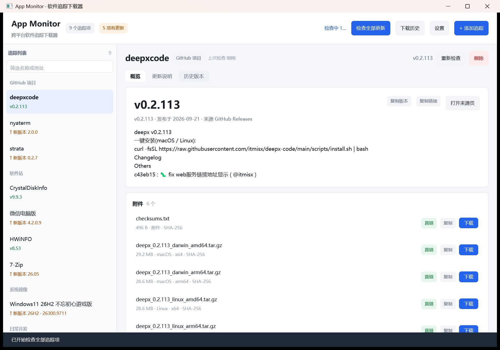
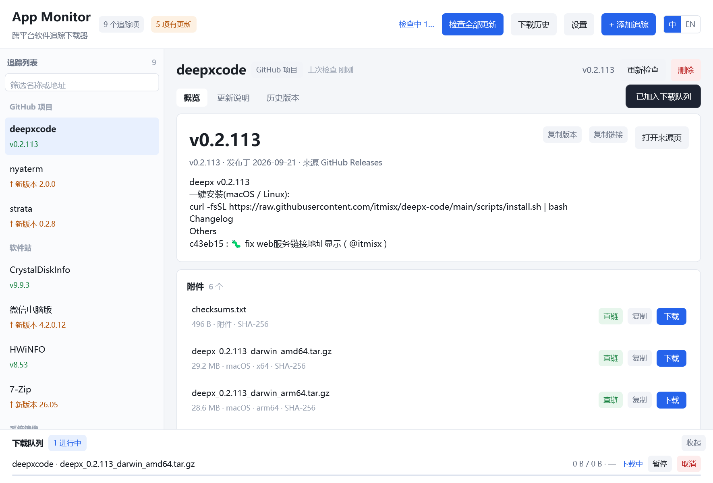
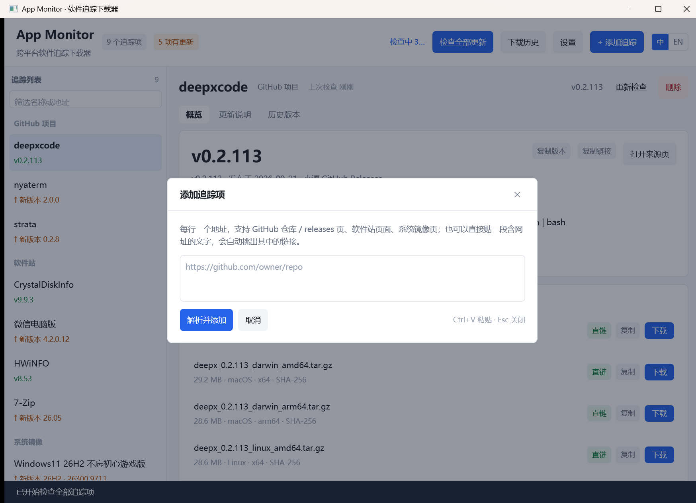
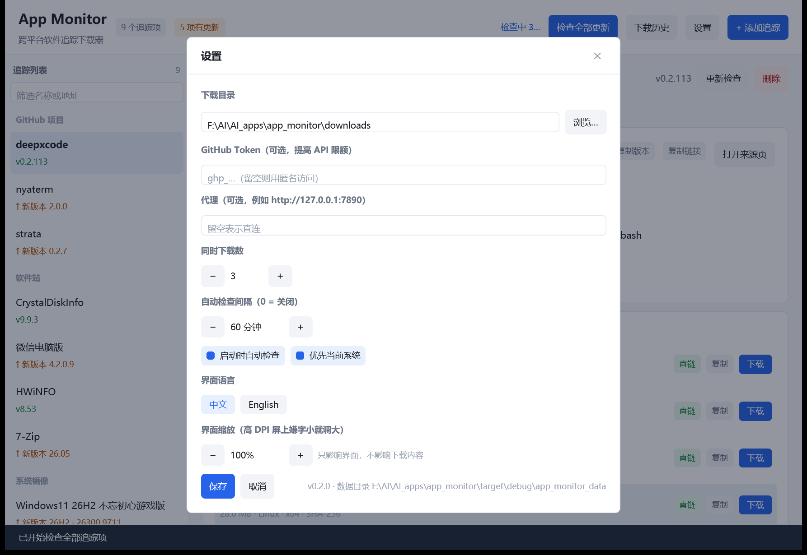
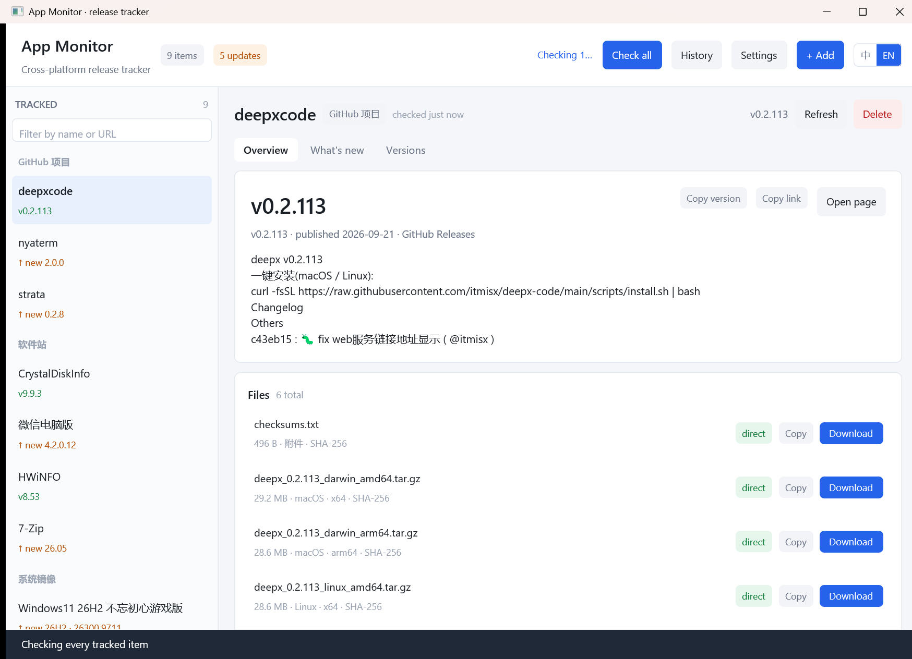
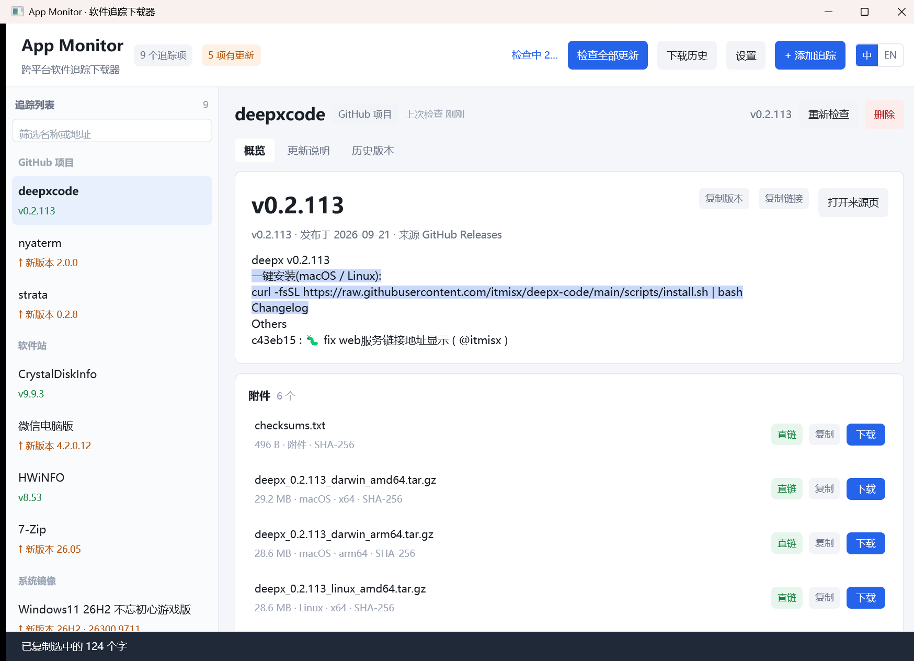
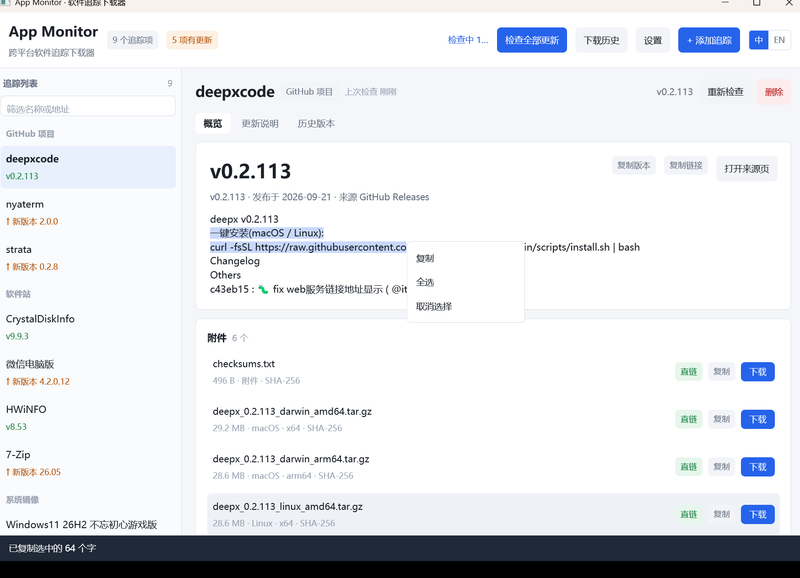
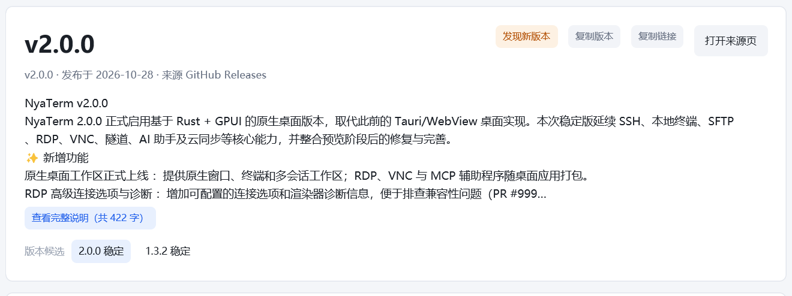

# App Monitor · 跨平台软件追踪下载器


用 Rust + GPUI 写的桌面小工具：**给它一堆「网站 / 仓库 + 软件名」，它替你盯着最新版本**，把版本号、发布时间、更新说明和下载直链整理到一张卡片上，你决定要不要下，它负责下（断点续传 + SHA-256 校验）。



```
┌──────────────────────────────────────────────────────────────────────┐
│ App Monitor  跨平台软件追踪下载器   [9 个追踪项]   检查全部更新 +添加…│
├───────────────┬──────────────────────────────────────────────────────┤
│ 追踪列表   9  │ nyaterm                       已是最新               │
│ GitHub 项目 3 │ GitHub 项目 · nyakang/nyaterm · GitHub Releases       │
│  deepxcode    │ 概览 │ 更新说明 │ 历史版本                            │
│  nyaterm      │ ┌──────────────────────────────────────────────────┐ │
│  strata       │ │ 最新版本  1.3.0        ⚠ 另有预发布 2.0.0-preview │ │
│ 软件站 4      │ │ 更新摘要 …                                        │ │
│  CrystalDisk… │ │ 下载文件 17 个：windows_x64.msi · 24.8 MB · sha…  │ │
├───────────────┴──────────────────────────────────────────────────────┤
│ 下载队列 1 个进行中          deepx_0.2.113_windows_amd64.zip         │
│ [██████████████░░░░░] 15.1 MB / 28.8 MB  5.0 MB/s   暂停  取消       │
└──────────────────────────────────────────────────────────────────────┘
```








## 下载（预编译）

从 [Releases](https://github.com/lordquest/app_monitor/releases) 直接下载，解压即用：

| 平台 | 文件 |
| --- | --- |
| Windows x64 | `app-monitor-v0.2.0-windows-x64.zip`（`app-monitor.exe`，需要 Windows 10 及以上） |
| Linux x64 | `app-monitor-v0.2.0-linux-x64.tar.gz`（需 X11/Wayland + Vulkan 驱动） |
| macOS arm64（Apple Silicon） | `app-monitor-v0.2.0-macos-arm64.tar.gz`（未签名，首次运行如被拦截执行 `xattr -d com.apple.quarantine ./app-monitor`） |

Windows 版可执行文件已在 Windows 上自测；Linux / macOS 二进制来自 GitHub Actions 同一份源码构建。版本号见 tag，本仓库目前对应 `0.2.0`。

## 特性

- **智能解析粘贴内容**：一行一个「地址 或 软件名」，自动判断是 GitHub 仓库、软件站首页下的产品名、还是具体文章页；重复项自动去重。
- **多来源解析**
  - GitHub：`releases.atom` + `releases/expanded_assets/<tag>` 解析（不消耗 REST API 配额），REST API 作为私有库/异常回退。
  - 软件站（WordPress/ZBlog 系）：站内搜索 `?s=<关键词>` → 结果打分 → 抓文章正文 → 抽出下载链接、版本号、更新说明。
  - 单篇文章：直接解析该页面。
- **版本看得懂**：优先稳定版；同仓库里混杂的 sub-crate 发布（`ignore-0.4.33`）会被降权。
- **多版本候选标签**：一个仓库同时存在多条发布线时（如 nyaterm 的稳定 `1.3.0` 与预览 `2.0.0-preview.7`），详情页版本卡片右下角会列出最多 3 个候选标签，点一下就切换成该版本的文件清单与更新说明，预览版用橙色标出。
- **下载器**：`Range` 断点续传、`.part` 临时文件、暂停/继续/取消/重试、并发上限、完成后 SHA-256 校验（GitHub 会公布每个附件摘要）。
- **每个能带走的东西都有按钮**：附件行的「直链 / 页面」标签本身就是动作（点了就下载 / 开浏览器），旁边还有「复制」拿链接；版本卡片可以「复制版本」「复制链接」，「更新说明」可以「复制全文」——版本号、文件名这类小字仍然只能靠按钮（正文本身能拖选，见两条之后）。
- **中英双语 + 界面缩放**：顶栏最右侧就是「中 / EN」切换，点了立刻生效并写进 `config.json`；`lang` 留空则跟随系统语言（第一次启动就是这样）。字号可在 80%–180% 之间按 10% 调整，高 DPI 屏上不再费眼（默认字号也比 v0.1 大一号）。
- **概览正文可以拖选复制**：GPUI 没有文本选中能力，这里用它的排版结果自己实现了高亮与命中（见下文），拖完松手就直接进剪贴板；想显式一点就在选区上右键，菜单里有「复制 / 全选 / 取消选择」，复制后选区还留着，可以接着再选。
- **历史与进度**：底部队列实时进度条 + 速度；历史记录页（成功/失败、校验结果、打开文件/目录）。
- **便携**：数据默认写在 exe 同级的 `app_monitor_data/`，整个目录拷走即迁移。

## 快速开始

```bash
cargo run            # 开发运行（Windows 需要 10 及以上；界面走 D3D11）
cargo run --release  # 发布运行
```

Windows 上如果 `cargo build --release` 报 `cl.exe exit code 2`（MSVC 环境探测被策略拦截），用自带包装脚本：

```bat
build-release.cmd
```

产物：`target/release/app-monitor.exe`，数据在 `target/release/app_monitor_data/`。

Windows 版通过 `.cargo/config.toml` 里的 `-C target-feature=+crt-static` 静态链接 MSVC 运行库（`/MT`），
二进制不依赖 `VCRUNTIME140.dll` / `api-ms-win-crt-*.dll`，在没装 VC++ 运行库的机器上也能直接双击运行，
代价是体积增加约 200KB。Linux / macOS 构建不受该配置影响。

### 自动发布（GitHub Actions）

`.github/workflows/release.yml` 在三个 runner 上并行 `cargo build --release`（Windows x64 / Linux x64 / macOS arm64），并把产物打包上传：

```bash
git tag -a v0.2.0 -m "app-monitor v0.2.0"   # 打 tag 即触发构建 + 发布 Release
git push origin v0.2.0
```

- 打 `v*` tag → 构建完成后自动创建 Release 并挂上三平台附件（含 `README.md` / `LICENSE`）。
- 在 Actions 页面手动 `Run workflow` → 只构建并保留 artifact（14 天），不发布，方便先验证。
- 构建使用 `Swatinem/rust-cache`，Linux 侧自动安装 GPUI 需要的 X11 / Wayland / fontconfig /
  freetype / Vulkan 开发包。
- 公开仓库的 Actions 分钟数不额外计费；release 附件按仓库流量计算。

首次启动会用内置的默认清单播种（就是本项目的示例清单），按 `Ctrl+N` 可以粘贴自己的清单。

## 支持的输入语法

粘贴框里一行一条，混着写也行：

```
https://github.com/itmisx/deepx-code  deepxcode          # 仓库 + 昵称
https://github.com/hooke007/mpv_PlayKit/releases  mpv-lazy @scene#54:"日常开发"
                                                          # @scene#N:"分组名" 给上面这条打分组
https://www.423down.com/                                  # 站点根，开启「站内搜索」上下文
CrystalDiskInfo                                           # ↓ 之后每行都是该站的搜索关键词
微信电脑版
7-Zip
https://masuit.org/                                       # 懒得勤快的博客（站内搜索 /search?wd=）
HWiNFO
https://www.pc528.net/
Windows11 26H2  不忘初心游戏版
https://www.423down.com/5228.html 7-Zip                    # 具体文章页
```

规则：

- 含 URL 的行会切换「当前上下文」；紧随其后的裸文本行都归属这个站点。
- `@scene#54:"日常开发"` / `@scene#7:工具` 引号可省；单独成行时，作用于**下一行**。
- 以 `#` 或 `//` 开头的行是注释。

## 各来源的解析策略

| 来源 | 做法 | 说明 |
| --- | --- | --- |
| GitHub 仓库 | `releases.atom` → 最新条目 → `releases/expanded_assets/<tag>` | 附件大小、上传日期、`sha256:` 摘要都在片段里；跳过 `.json/.blockmap/.yml` 之类的更新清单 |
| 软件站 | `?s=<关键词>` 搜索 → 标题打分 → 文章正文 | 打分含中文 bigram、同义词（电脑版→pc版）、惩罚词（补丁/插件/注册机/旧版…），避免抓成「XX 补丁」 |
| 423down | 同上；`/go.php?url=<base64>` 自行解码成真实网盘地址 | |
| pc528 | 同上；首次 403 + `Set-Cookie` 挑战会自动重试一次 | 下载区需登录，卡片上会提示 |
| masuit.org | 站内搜索走 `/search?wd=<关键词>`，结果为 `article-card` 卡片（无 `<h2>`） | 只给蓝奏云链接，下载需在浏览器打开 |
| 通用 | 文章正文按 `entry-content` 等容器切片，锚点分类为 直链 / 网页 / 网盘 | 直链按「当前系统 > 未知 > 其它系统」排序，附件摘要类文件排在后面 |

## 多版本候选（版本线）



同一仓库的不同发布线会被收进「版本候选」，最多 3 个标签，避免把预览版只写在一行警告里：

| 例子 | 候选 | 说明 |
| --- | --- | --- |
| `nyaterm` | `1.3.0 稳定` / `2.0.0-preview.7 预览` / `1.2.12 稳定` | 稳定版仍为「最新版本」，预览版以橙色标签并列 |
| `mpv_PlayKit` | 只有 1 个 | 日期式 tag（`20260510`）属于同一条线，不会一天一个标签 |
| `deepx-code` | 只有 1 个 | `0.2.x` 是同一 line，旧版本只在「历史版本」里看 |

规则：按 `主版本.次版本` 归并同一条线（`2.0.0-preview.7` → `2.0`），每条线只保留最新一条；稳定版排第一，其次是预览线，再是其它线。切换标签只影响显示与下载目标，`seen_version`（更新提示）始终以稳定版为准。

## 下载行为

- 直链（`.exe/.zip/.msi/.7z/.dmg/.tar.gz`…）排队下载到 `<下载目录>/<软件名>/<版本>/`，重名自动加 ` (1)`。
- 网盘链接、网页跳转链接不会偷偷下，只在浏览器打开（`打开链接`）。
- 下载请求会带上来源页 `Referer` 与站内 Cookie（部分站点防盗链）。
- **大文件不设总时限**：下载客户端只有 15s 连接超时 + 30s「读停顿」检测，传输本身不限时长（174MB 在 2MB/s 下要 90s，卡总时限会把正常下载掐断）。页面解析仍保留 55s 总时限。
- **断流自动续传**：中途读超时、对端提前关闭连接时，任务内部带 `Range` 自动接着下（连续 3 次毫无进展或累计 20 次才判定失败），不需要手点「继续」。
- 已完成任务可 `打开文件` / `打开目录`；失败任务可 `重试`；已结束任务可一键清空。

## 数据文件

`app_monitor_data/`（exe 同级；不可写时回退到系统数据目录）：

| 文件 | 内容 |
| --- | --- |
| `config.json` | 下载目录、GitHub Token、代理、并发数、自动检查开关/间隔 |
| `tracks.json` | 追踪清单与最近一次的解析结果（离线也能看到上次数据） |
| `history.json` | 下载历史（最多 500 条） |

**文件读不动时不会静默清空**：`config.json` / `tracks.json` / `history.json` 只要是非法 JSON（手工改错、被别的程序写坏）或零字节（写到一半断电），程序会先把它改名成 `<原名>.<UTC 时间>Z.corrupt` 留在同目录，再用默认内容启动，并在窗口顶部显示一条横幅说明是哪个文件、备份叫什么。旧版本在这种情况下会直接拿默认清单顶上，下一次保存就把原文件盖掉了——自建的追踪项、Token 会连痕迹都不剩。

配置项（设置窗口 `Ctrl+,`）：

- **下载目录**：默认 `<系统下载目录>/AppMonitor`，可改成任意路径（当前实例已指向工程内 `downloads/`）；文件按 `<软件名>/<版本>/` 归档。
- **GitHub Token（可选）**：只在回退到 REST API 时使用，平时走 atom 不消耗配额。
- **代理**：留空则直连；也遵循 `HTTPS_PROXY` 环境变量。
- **同时下载数 / 自动检查间隔（分钟）**。

## 下载链路的安全取舍

- **拒绝 https → http 降级跳转**：HTTPS 一旦跳回明文，链路上任意一跳（公共 WiFi、运营商注入、透明代理）都能把安装包换掉，而这个程序下载完是准备双击运行的。GitHub 之外的附件基本没有 SHA-256 可比，事后发现不了。链长上限 12 跳。
- **不拦「本来就是 http」的链接**：那是站点的既有事实，硬拦会让一大批只提供 http 的国内站点整个失效。这类链接在下载列表里以红色 `· 明文 http` 标出，由你自己判断。
- **没有摘要就直说**：非 GitHub 附件通常没有官方 SHA-256，列表里写 `· 无官方摘要，下载后无法校验`，而不是让人误以为校验过了。

真实站点偶尔不守规矩（https 页面跳到 http 的 CDN），这时可以开逃生阀——**只放宽下载，解析仍严格**（页面内容决定版本号和下一个下载地址，被换掉等于整套判断被人接管）：

```bash
AM_ALLOW_DOWNGRADE=1 app-monitor    # Windows: set AM_ALLOW_DOWNGRADE=1 && app-monitor.exe
```

打开后启动日志会打一条 warn，提示包体可能被中途替换。

## 快捷键

| 键 | 作用 |
| --- | --- |
| `Ctrl+1 / 2 / 3` | 概览 / 更新说明 / 历史版本 |
| `Ctrl+N` | 添加追踪 |
| `Ctrl+F` | 聚焦侧栏筛选框 |
| `Ctrl+H` | 下载历史 |
| `Ctrl+,` | 设置 |
| `Esc` | 关闭弹窗 |

## 命令行自测

```bash
app-monitor --check            # 解析全部追踪项，打印版本 / 摘要 / 附件 / 警告
app-monitor --check HWiNFO     # 只跑名字里含 HWiNFO 的条目
app-monitor --check --verbose  # 额外打印正文开头与长度，排查站点解析
app-monitor --fetch <url> [--save out.html]   # 用应用自己的 HTTP 栈抓一个页面，看状态码/标题
app-monitor --download-test    # 真下载第一个 GitHub 项的 Windows 附件并校验 SHA-256 到 ./.selftest
app-monitor --download Netcatty --asset win-x64.zip   # 下载指定条目的指定附件（大文件/续传问题复现用）
app-monitor --select nyaterm              # 打开 GUI 并直接定位到某个条目
app-monitor --select nyaterm --cand 1     # 再指定打开第 2 个版本候选（截图/复现用）
```

`--check` 不需要图形环境，适合放进定时任务里做巡检。

## 界面层（GPUI）

界面用 [GPUI](https://www.gpui.rs/)（Zed 的 GPU UI 框架）实现，只有这一套 UI，没有并存分支。
换掉 egui 的理由：

- 渲染路径统一，不需要自己维护「DX12 → WARP → glow」的后端选择与失败兜底：
  Windows 走 Direct3D 11 + DirectComposition，macOS 走 Metal，Linux 走 Vulkan/blade。
- 依赖树小得多（不再带 eframe / egui / wgpu / naga / glow）：`Cargo.lock` 里的包从 833 个降到
  724 个，少 109 个 crate、约 1.3k 行锁文件。

代价是**只支持 Windows 10 及以上**：D3D11 + DirectComposition 在更早的系统上不完整。
Win7/8 用户请留在 [v0.1.2](https://github.com/lordquest/app_monitor/releases/tag/v0.1.2)
（最后一个 egui 版本）。

```bash
AM_LOG=1 app-monitor              # 打开调试日志
AM_ALLOW_DOWNGRADE=1 app-monitor  # 下载允许 https → http 降级（逃生阀，见上一节）
AM_START_DIALOG=settings app-monitor   # 启动即打开弹窗：add / settings / history（截图与复现用）
AM_LOG_MOUSE=1 app-monitor        # 把鼠标按下事件与缩放因子打到 stderr，排查「点了没反应」
AM_LANG=en app-monitor            # 临时切英文界面（不写 config.json）
AM_UI_SCALE=1.3 app-monitor       # 临时按 130% 缩放界面（不写 config.json）
```

### 自绘输入框

GPUI 0.2 没有内置文本控件，所以「添加追踪 / 设置 / 筛选」三处的输入框是自己实现的：

- 支持可打印字符、退格、Delete、左右 / Home / End、**Ctrl+V 粘贴**、Ctrl+A 全选后再输入即替换；
- **不走输入法（IME）**：这三处填的是 URL、目录、Token、代理地址，全是 ASCII；粘进来也不受
  键盘布局影响。追踪项的名称由 URL 推导，不需要手工键入中文。
- 编辑逻辑抽成了 `EditState`（纯字符串、不碰窗口），因此 UTF-8 边界、CRLF 归一这些容易出错的
  地方都有单测覆盖。

### 快捷键的两个坑

- `Window::on_action` 只能在 dispatch 树构建期间（也就是元素渲染时）注册，窗口刚建好就注册会
  在 `key_dispatch.rs` 里 `unwrap()` 到 `None` 直接 panic。所以 action 监听挂在根元素的
  `.on_action(...)` 上。
- 一个可聚焦元素都没有时，按键派发的 `active_node` 为空，同样会 panic。根元素因此也
  `track_focus`，并在没有弹窗时持有焦点；打开弹窗则把焦点交给输入框。

### 布局：换行文本必须给确定宽度

GPUI 把尺寸计算交给 taffy。**自动宽度的换行文本**（`whitespace_normal()`）在量高度时用的是
min-content 宽度（最长单词的宽度），于是渲染出来看着换行正常，卡片下半截却多出几百像素的空白；
更糟的是，宽度撑不住时整行文字会顶出窗口右边缘、把右边的按钮挤到看不见（早期版本里 nyaterm
的「下载」按钮就是这样消失的）。两条规矩：

- 排成一行的兄弟元素，文本那格要 `min_w_0()` + `text_ellipsis()`，按钮要 `flex_shrink_0()`；
- 需要换行的长文本，用 `render()` 里按窗口宽度算出的确定宽度（`main_panel` 收到的 `text_w`）。

### 字号、界面缩放与中英双语

**缩放不是 DPI 系数**。GPUI 的逻辑像素已经按系统缩放换算成物理像素了（150% 时 1 逻辑像素 =
1.5 物理像素），所以再乘一遍 DPI 只会把界面放大两次。真正的问题是「11 逻辑像素在 4K 屏上照样
小」（Windows 默认界面字号是 9pt ≈ 12 逻辑像素），因此这里给的是一个用户可调的 `ui_scale`
（0.8–1.8，存进 `config.json`），默认值 1.0 对应的字号已经比 v0.1 大一档。

- 所有字号、行高、输入框高度、侧栏宽度都走 `sp(n)`（设计值 × `ui_scale`）。`badge()` / `chip()`
  这类自由函数没有 `self`，所以系数放在进程级静态量里 —— 界面只有一个窗口，缩放本来就是全局的。
- 换行文本的宽度（`render()` 里的 370 那个常数）也要跟着缩放，否则放大字号后卡片会窄一截。

**本地化**用 `i18n::t(中文, English)`，两句话就地写在调用处：漏翻的地方在英文界面上一眼能看出
（还剩一句中文），也不会出现「键对不上悄悄回退」的问题。语言同样是进程级静态量，理由是
`Tab::label()` / `SourceKind::label()` / `util::fmt_secs_ago()` 连 `App` 都拿不到。

- **语言的选择入口有两个**：顶栏最右侧的「中 / EN」和设置里的三态（中文 / English / 跟随系统）。
  放顶栏是因为「界面全是外语，我找不到哪儿改语言」是个死胡同 —— 那几颗字用户本来就不认识。
- `config.json` 的 `lang` 留空表示**跟随系统**，启动时用 `GetUserDefaultUILanguage` 判一次（只看
  主语言 ID 是不是 0x04）。检测结果不写回文件：用户临时改了系统语言，下次启动还能跟上。
- `history.json` 里的状态存**中文常量**（`完成` / `失败` / `已取消`），显示时才翻译 —— 历史文件
  是跨语言共用的，存 `done` 再切回中文就翻不回来了。
- 窗口标题跟着语言变：`&mut Window` 只有绘制阶段拿得到，所以在 `render` 里按需设一次。
- 英文界面用 Segoe UI，中文继续用雅黑。

### 概览正文的拖选：没有改 GPUI，用它的排版结果自己画

GPUI 0.2.2 没有文本选中：`Text` / `StyledText` 只负责把字画出来，不认拖选，也没有选区这个概念
（`grep -ri selectable` 只能查到输入框和剪贴板）。但排版结果 `WrappedLine` 里每个字形的 x 坐标
都留着，`closest_index_for_position` 能把鼠标位置换回字节索引 —— 所以选中不必 fork GPUI：

1. `select_text::prepare()` 用与 `Text` 同一个 `shape_text` 排一次版，拿到行、段和总高度；
2. `select_text::paint()` 先画选区矩形（`window.paint_quad`），再逐行 `WrappedLine::paint` 画字；
3. 鼠标事件挂在外面那层 div 上，命中走 `Prepared::index_at`，选区状态放在 `App` 里。

几个必须踩对的地方：

- **段与段的偏移要补 `\n`**：`shape_text` 返回的每个 `WrappedLine` 对应一个 `\n` 分段，`len()`
  不含换行符，累加偏移时漏掉这 1 个字节，后面所有命中都会错位。
- **折行边界是「上一行最后一个字形的字节位置」**，下一行从 `+1` 开始 —— 这与
  `position_for_index` 内部的分行判断一致，直接用 `+1` 之外的切法会在换行处错半个字。
- 高亮的 x 要用 `x_for_index(i) - x_for_index(行首)`：中英混排会换字体，绝对坐标对不上。
- 命中给的字节索引理论上都落在字符边界，但 `+1` 之后可能掉进多字节字符中间，复制前统一过一遍
  `snap_to_char`，否则 `&str[a..b]` 直接 panic。
- **松手即复制**：GPUI 的 Ctrl+C 要走焦点与 action，还得跟输入框抢这个快捷键；这段文字的唯一用途
  就是被带走，所以拖完直接进剪贴板，回执里报字数。
- **右键菜单自己画**：GPUI 0.2.2 没有上下文菜单，`ctx_layer` 用一个整窗透明遮罩接「点别处关掉」，
  菜单是绝对定位的白卡片。两条硬要求：菜单项必须在**按下**时行动（`on_mouse_down` 而非 `on_click`），
  并且在遮罩与菜单项上都要 `cx.stop_propagation()` —— 菜单浮在正文之上，事件继续往下走的话正文会
  收到这次按下，把刚选好的选区改成空选区，于是「复制」晚一步执行就只剩「没有选中文字」。
- 代价是这段文本不再走 GPUI 的文本元素，字号、行高、颜色都得自己给（`selectable_body` 里一次给全），
  否则字会跳一下。

**弹窗的高度**有个坑：`max_h` 只把卡片外框裁短，里面的 flex 布局拿不到「有界的高度」，内容
会顶出卡片再被 `overflow_hidden` 切掉（设置项一多，底部的「保存」就点不到了）。所以内容区自己
还要再限一次高并 `overflow_y_scroll()`，滚动条才会真的出现。

### exe 图标：必须编进资源段，不能运行时设置

第一版发出去的 exe 在资源管理器、任务栏、Alt-Tab 里都是 Windows 那个空白默认图标——因为
项目里根本没有图标资源，也没人告诉链接器要带一个。

- 图标来自 PE 里的 `RT_GROUP_ICON`，运行时调用 `SetClassLongPtr` 只能改已经被创建出来的
  窗口，改不了「这个 exe 长什么样」。
- GPUI 的 Windows 后端在 `load_icon()` 里是这么取的：
  `LoadImageW(GetModuleHandleW(None), PCWSTR(1 as _), IMAGE_ICON, ..)`——**资源 ID 写死为 1**，
  所以 `.rc` 里那行必须是 `1 ICON "assets/app.ico"`（ID 换成别的，窗口类就拿不到图标）。
- `build.rs` 用 `embed-resource` 把资源编成 `.lib` 交给链接器；非 Windows 目标整段跳过。
  没装 Windows SDK、找不到 `rc.exe` 时只 `cargo:warning`，不让构建失败。

图标本身在仓库里是成品（`assets/app.ico`），要改颜色/形状就改脚本重生成：

```powershell
powershell -File tools/build-icon.ps1   # 按 16/20/24/32/40/48/64/128/256 逐尺寸直接绘制
python tools/pack_ico.py                # 拼成 ICO：≤64 用 32bpp DIB，128/256 用 PNG
```

逐尺寸绘制而不是「画一张大图再缩」，是因为 16px 缩下去箭头会糊成一团；小尺寸那边单独把
箭头和托盘加粗了一档。打包脚本不用 Pillow（机器上没有），ICO 容器就是
`ICONDIR + 目录项 + 各尺寸数据`，自己拼比装依赖省事。

**别往 `.rc` 里塞 manifest。** `gpui.lib` 里已经带了一份 `RT_MANIFEST`（声明
`PerMonitorV2` + Common-Controls），再放一份同 ID 的资源会让 `CVTRES` 直接报
「资源重复 (CVT1100)」、链接失败；换成 `/MANIFESTINPUT` 合并也一样，因为冲突的是资源本身
而不是链接器生成的那份。顺带说明：DPI 感知一直是有的，界面在高分屏上不是靠系统拉伸的。

Windows 会缓存 exe 图标：换新版本后如果资源管理器还显示旧图标，`ie4uinit.exe -show`
或重启一次 `explorer.exe` 就好。

## 已知限制

- **HWiNFO** 已改由 masuit.org（懒得勤快的博客）追踪——423down 未收录这个软件。该站有 Cloudflare 人机验证，偶尔会超时，重试即可；被挡住时卡片会提示改用浏览器打开。
- pc528 的下载区需要登录/回复可见，卡片会标注，需点「打开来源页面」。
- 网盘（夸克/百度/蓝奏/123）只能在浏览器打开，不参与自动下载。
- 自绘输入框不支持中文输入法；这几处不填中文，需要中文标题时靠粘贴。
- **只有概览与「更新说明」的正文能拖选**：GPUI 0.2.2 没有文本选中，这两块是自己画的可选中文本；版本号、文件名这类小字仍然靠按钮复制（附件「复制」、版本卡片「复制版本 / 复制链接」、「复制全文」）。
- **英文界面只翻界面文案**：条目名、分组名、release 正文都来自上游数据，保持原文（很多仓库的更新说明本来就只有中文）。
- 界面要求 Windows 10 及以上；Win7/8 只能用 v0.1.2。
- 软件站解析依赖站内搜索的 HTML 结构，站点改版可能导致匹配失败——`--check --verbose` 可快速定位。
- 若下载返回 403，多为代理/防火墙拦截或站点防盗链，可先用 `打开来源页面` 在浏览器里确认。

## 目录结构

```
src/
  main.rs          入口、崩溃弹窗、--check / --download / --download-test / --fetch
  ui.rs            界面：状态与消息泵、顶栏 / 侧栏 / 详情 / 队列、自绘输入框与弹窗
  engine.rs        后台任务通道（tokio runtime + mpsc）
  download.rs      断点续传下载器 + SHA-256
  http.rs          HTTP 客户端、per-host cookie、错误中文化
  html.rs          轻量 HTML 工具（实体解码、标签剥离、锚点、正文切片）
  parse.rs         粘贴内容 → 追踪项
  provider/        github.rs / site.rs / mod.rs（调度与附件排序）
  model.rs         数据结构、平台判定
  store.rs         数据目录与 JSON 读写（tmp + rename，坏文件先隔离再重建）
  util.rs          版本比较、标题打分、字节/时间格式化
```

## 许可证

MIT
